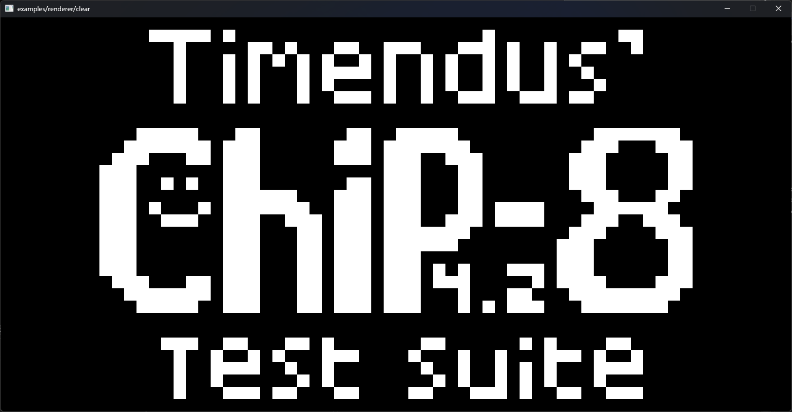
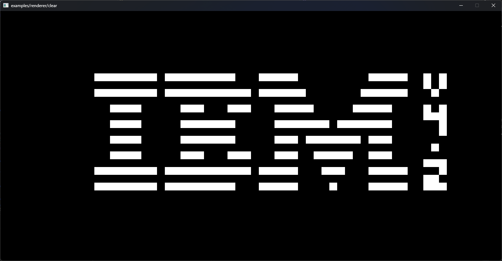
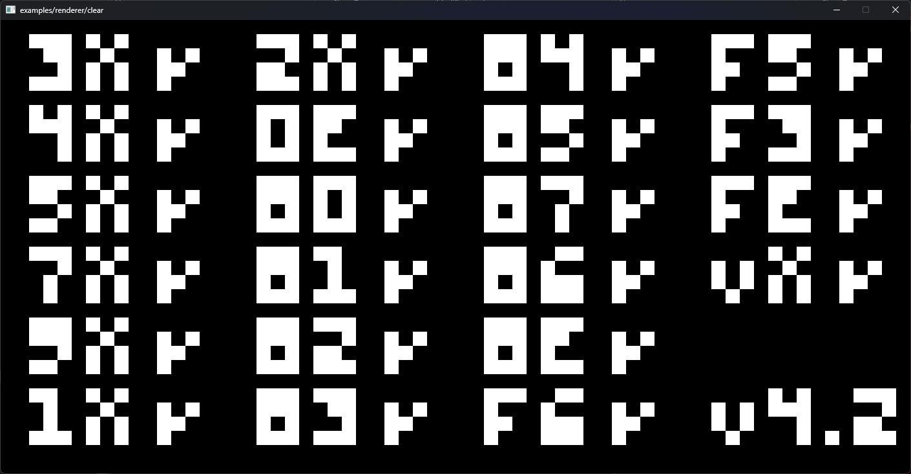
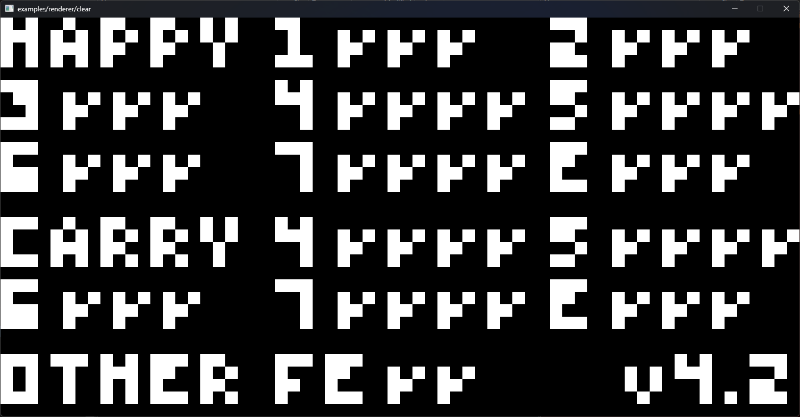
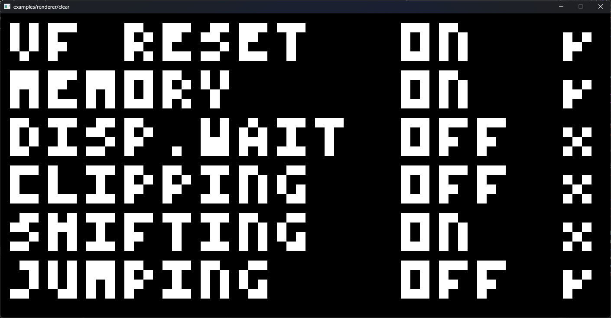
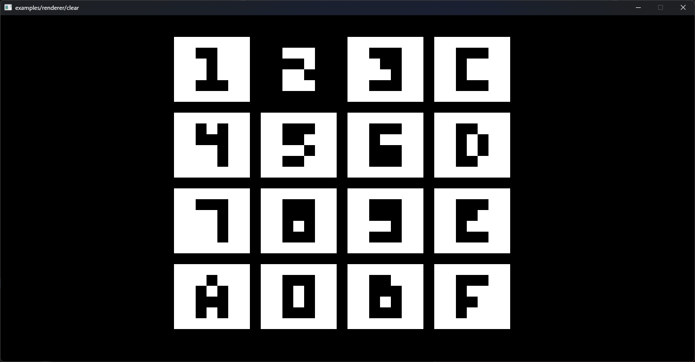
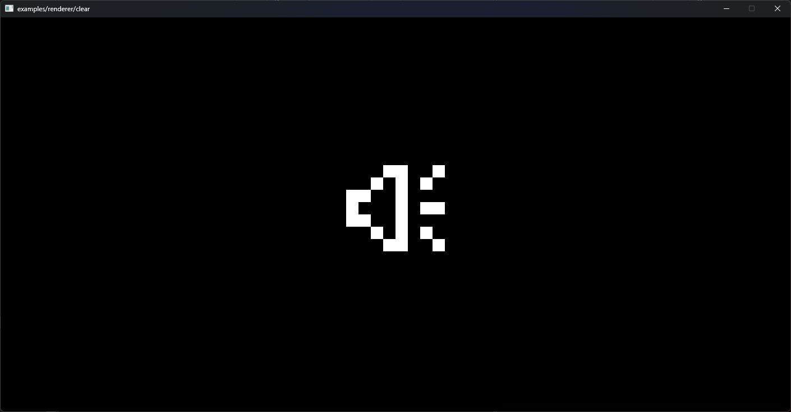
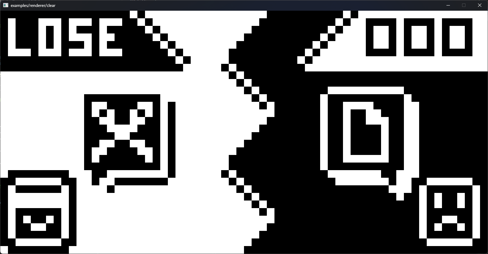

# Chip-8 Emulator
An emulator for the Chip-8 hardware written in C++ with SDL3 for rendering based on [Cowgod's](http://devernay.free.fr/hacks/chip8/C8TECH10.HTM) documentation from 1997

| CHIP-8 Logo | IBM Logo | Opcode Test (Corax+) | Flags Test |
| :---: | :---: | :---: | :---: |
|  |  |  |  |
| **Quirks Test** | **Keypad Test** | **Audio Beep Test** | **Rock Paper Scissors** |
|  |  |  |  |

## Keyboard mapping

The original CHIP-8 16-key hexadecimal keypad is mapped to a 4x4 grid on standard QWERTY keyboards:

```text
QWERTY Keyboard:             CHIP-8 Keypad:
+---+---+---+---+            +---+---+---+---+
| 1 | 2 | 3 | 4 |            | 1 | 2 | 3 | C |
+---+---+---+---+            +---+---+---+---+
| Q | W | E | R |   ====>    | 4 | 5 | 6 | D |
+---+---+---+---+            +---+---+---+---+
| A | S | D | F |            | 7 | 8 | 9 | E |
+---+---+---+---+            +---+---+---+---+
| Z | X | C | V |            | A | 0 | B | F |
+---+---+---+---+            +---+---+---+---+
```

## Getting started

### Prerequisites
* **C++ Compiler** supporting C++17 or later (MSVC, GCC, or Clang)
* **CMake** (v3.20 or newer)
* **Git**

### 1. Clone the repository
Clone with `--recursive` because SDL3 is a submodule
```bash
git clone --recursive https://github.com/Anomi132/CHIP-8-Emulator.git
cd CHIP-8-Emulator
```

### 2. Build the Project

Debug
```bash
cmake -B build
cmake --build build --config Debug
```

Release
```bash
cmake -B build
cmake --build build --config Release
```

### 3. Running a ROM
Run the compiled executable from your build directory:

```bash
# On Windows:
& '.\build\CHIP-8 Emulator\Release\chip8.exe'

# On Linux:
./build/CHIP-8\ Emulator/chip8 
```
